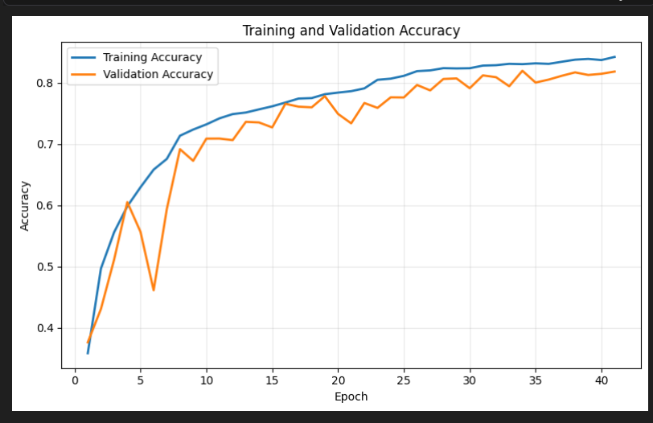
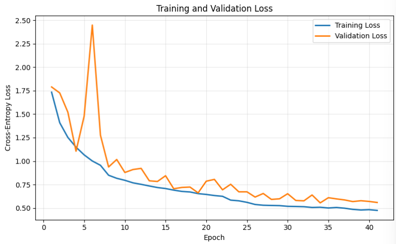

# residual-cnn-image-classification
Custom Residual CNN for CIFAR-10 image classification with Grad-CAM interpretability, achieving 81.68% test accuracy.
# Residual CNN for CIFAR-10 Image Classification

## Project Overview

This project implements a custom Residual Convolutional Neural Network (CNN) using TensorFlow and Keras to classify images from the CIFAR-10 dataset into 10 categories.

The model achieved **81.68% test accuracy** and uses Grad-CAM to visualize the image regions influencing its predictions.

## Technologies Used

- **Language:** Python
- **Deep Learning:** TensorFlow, Keras
- **Machine Learning:** Scikit-learn
- **Data Processing:** NumPy, Pandas
- **Visualization:** Matplotlib, Seaborn
- **Development:** Jupyter Notebook

## Dataset

The CIFAR-10 dataset contains 60,000 colour images across 10 categories: airplane, automobile, bird, cat, deer, dog, frog, horse, ship, and truck.

The dataset was divided into:

- Training: 42,000 images (70%)
- Validation: 9,000 images (15%)
- Testing: 9,000 images (15%)

Images were normalized to the range [0, 1]. Data augmentation included horizontal flipping, rotation, zooming, and translation.

## Model Architecture

The custom Residual CNN incorporates:

- Convolutional layers for visual feature extraction
- Residual skip connections to support gradient flow
- Batch normalization for training stability
- Dropout for regularization
- A classification output layer for 10 categories

The model was trained using the AdamW optimizer with learning-rate scheduling, early stopping, and model checkpointing.

## Model Performance

| Metric | Result |
|---|---|
| Test Accuracy | 81.68% |
| Training Accuracy | Approximately 84.2% |
| Validation Accuracy | Approximately 81.8% |

Model performance was evaluated using accuracy, precision, recall, F1-score, and confusion matrices.

The evaluation identified confusion between visually similar categories, particularly cats and dogs.

## Explainable AI — Grad-CAM

Grad-CAM (Gradient-weighted Class Activation Mapping) was implemented to visualize which image regions contributed to the model's predictions.

These visualizations helped examine both correct classifications and misclassifications, providing insight into the model's decision-making behaviour.

## How to Run

1. Download or clone this repository.
2. Install the required Python libraries.
3. Open `residual_cnn_cifar10.ipynb` in Jupyter Notebook or Google Colab.
4. Run the notebook cells sequentially to load the dataset, train the model, evaluate performance, and generate Grad-CAM visualizations.

Training may take considerable time depending on available hardware.

## Key Learning Outcomes

- Designed and trained a custom deep learning architecture.
- Applied preprocessing, augmentation, and regularization techniques.
- Evaluated model generalization using multiple classification metrics.
- Implemented Grad-CAM to investigate model predictions and classification errors.

## Project Type

Individual academic deep learning project.

## Training Results

### Training and Validation Accuracy

### Training and Validation Loss

